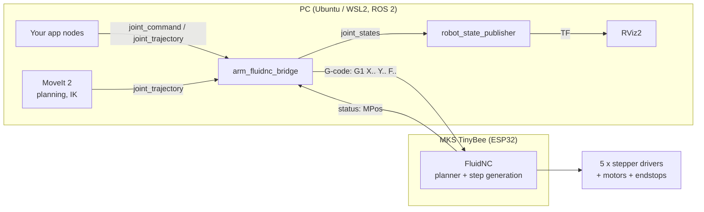

# 1. Architecture

## Overview

## Why FluidNC as the motion controller

FluidNC is CNC firmware. It already does what a stepper-based arm needs at the low level:

* real-time step generation for up to 6 axes (TinyBee has 5 driver sockets),
* acceleration-limited, **coordinated** moves (all joints start and finish together),
* homing with endstops, soft limits, feed hold, reset, alarms,
* USB serial and Wi-Fi (telnet / WebSocket / WebUI) interfaces.

The trick: configure every FluidNC axis as a **joint** with units of **degrees**
(`steps_per_mm` = steps per degree). A G-code line `G1 X30 Y-10 F1200` then means
"move base to 30°, shoulder to −10°". FluidNC knows nothing about arm kinematics – ROS 2
does all of that (URDF, IK, planning).

## Responsibilities

| Layer | Responsible for |
|-------|-----------------|
| FluidNC | Steps, acceleration, joint limits (soft limits), homing, emergency stop |
| `arm_fluidnc_bridge` | rad ⇄ deg conversion, G-code generation, flow control (send → wait for `ok`), publishing `joint_states` |
| `arm_description` | Geometry, joint axes and limits (URDF) |
| MoveIt 2 (later) | Inverse kinematics, collision-free planning, Cartesian paths |
| Your nodes | Tasks: pick & place, teleoperation, vision… |

## Known limitations of this design (and upgrade paths)

1. **Open loop** – FluidNC reports *commanded* position, not measured. Missed steps go
   unnoticed. Mitigations: conservative speeds/currents, homing at startup, later add
   magnetic encoders (AS5600/AS5048) on joint outputs.
2. **Trajectory fidelity** – a trajectory is sent as a series of `G1` segments with feed rates
   derived from `time_from_start`. FluidNC's planner blends them, so timing is approximate.
   Fine for pick & place; not for tight real-time control.
3. **Feed rate semantics** – FluidNC computes feed over the vector length of all axes.
   The bridge accounts for that, but per-joint velocity is only indirectly controlled.
4. **Next step**: replace the topic-based bridge with a C++ **`ros2_control` hardware
   interface** (`SystemInterface`) so standard controllers
   (`joint_trajectory_controller`) and MoveIt 2 work out of the box. Keep
   `fluidnc_protocol.py` logic as reference. See [06-ros2-software.md](06-ros2-software.md).

## Joint / axis mapping

| ROS joint | Function | FluidNC axis | TinyBee socket | Endstop pin |
|-----------|----------|--------------|----------------|-------------|
| joint1 | base yaw | X | X | gpio.33 (X-MIN) |
| joint2 | shoulder pitch | Y | Y | gpio.32 (Y-MIN) |
| joint3 | elbow pitch | Z | Z | gpio.22 (Z-MIN) |
| joint4 | wrist pitch | A | E0 | none (optional) |
| joint5 | wrist roll | B | E1 | none (optional) |
| gripper | open/close | C (optional RC servo) or separate MCU | EXP1 GPIO | – |

Keep this table consistent across: `config.yaml`, `arm.urdf.xacro`, `fluidnc_bridge.yaml`.
