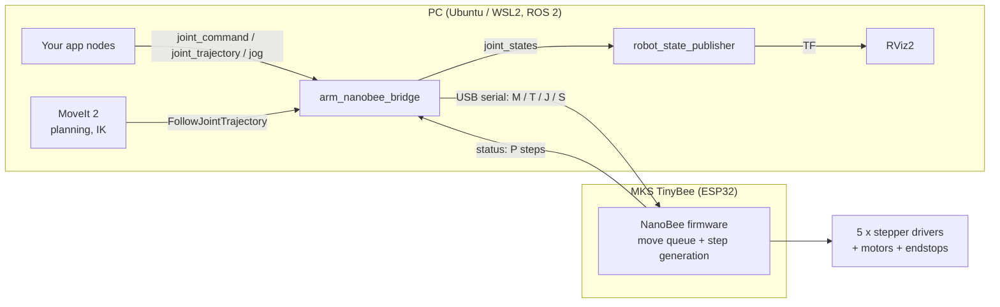

# 1. Architecture

## Overview

## Why NanoBee as the motion controller

NanoBee ([NanoBee/](../NanoBee)) is this project's own minimal firmware for the TinyBee. It does
only what a stepper-based arm needs at the low level:

* real-time step generation for the 5 driver sockets,
* acceleration-limited, **coordinated** moves (`M`: all joints start and finish together),
* **timed segments** (`T p0..p4 dt_ms`) that blend without stopping (`motion.blend`), so a
  ROS trajectory is followed point by point with its timing,
* velocity jog with a watchdog (`J`), smooth stop (`S`) and instant halt (`!`),
* homing (`none` / `edge` / `center` per joint), soft limits per joint,
* a USB serial line protocol (used by ROS) and a Wi-Fi web page for setup and testing.

Firmware positions are **motor steps** per joint; `joints.jointN.steps_per_deg` in the board's
`config.yaml` converts them (`T 533 0 0 0 0 1000` = base to 30° in 1 s at 17.7778 steps/deg).
NanoBee knows nothing about arm kinematics – ROS 2 does all of that (URDF, IK, planning).

## Responsibilities

| Layer | Responsible for |
|-------|-----------------|
| NanoBee | Steps, acceleration, speed limits, soft limits, homing, stop/halt |
| `arm_nanobee_bridge` | rad ⇄ steps conversion (with the board's `steps_per_deg`), `M`/`T`/`J` command generation, flow control (send → wait for `ok`/`err`), trajectory checks, publishing `joint_states` |
| `arm_description` | Geometry, joint axes and limits (URDF) |
| MoveIt 2 | Inverse kinematics, collision-free planning, Cartesian paths |
| Your nodes | Tasks: pick & place, teleoperation, vision… |

## Known limitations of this design (and upgrade paths)

1. **Open loop** – NanoBee reports *commanded* position, not measured. Missed steps go
   unnoticed. Mitigations: conservative speeds/currents, homing at startup, later add
   magnetic encoders (AS5600/AS5048) on joint outputs.
2. **Trajectory fidelity** – each trajectory point becomes one constant-speed `T` segment
   (linear interpolation between points), plus a short deceleration ramp at the end.
   Velocities/accelerations of the points are not tracked separately. Fine for pick & place;
   not for tight real-time control.
3. **Serial streaming** – segments are sent one by one over 115200 baud into a 32-entry queue;
   if the queue runs empty mid-trajectory the board warns and the bridge aborts the goal.
4. **Next step**: replace the topic-based bridge with a C++ **`ros2_control` hardware
   interface** (`SystemInterface`) so standard controllers
   (`joint_trajectory_controller`) work out of the box. Keep
   `nanobee_protocol.py` logic as reference. See [06-ros2-software.md](06-ros2-software.md).

## Joint / axis mapping

| ROS joint | Function | NanoBee joint | TinyBee socket | Endstop pin |
|-----------|----------|---------------|----------------|-------------|
| joint1 | base yaw | J0 | X | GPIO 33 (X-MIN), `center` homing |
| joint2 | shoulder pitch | J1 | Y | GPIO 32 (Y-MIN), not used yet |
| joint3 | elbow pitch | J2 | Z | GPIO 22 (Z-MIN), not used yet |
| joint4 | wrist pitch | J3 | E0 | none |
| joint5 | wrist roll | J4 | E1 | none |
| gripper | open/close | RC servo (`G us`) or separate MCU | servo header, GPIO 2 | – |

Keep this table consistent across: `NanoBee/src/config.h` (pins), `NanoBee/NanoBeeDriver/config.yaml`,
`arm.urdf.xacro`, `nanobee_bridge.yaml` (`joint_names` in firmware order).
